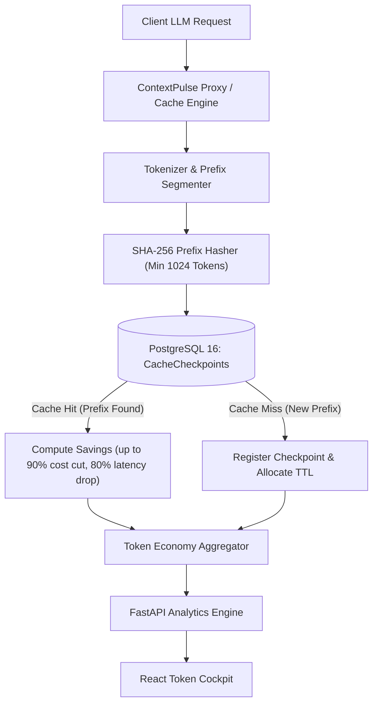

# ⚡ ContextPulse — LLM Context Caching & Token Economy Optimizer

[](https://fastapi.tiangolo.com)
[](https://www.postgresql.org)
[](https://www.sqlalchemy.org)
[](https://python.org)
[](https://opensource.org/licenses/MIT)

> **ContextPulse** is an intelligent context caching proxy and token economy analyzer designed for LLM applications. It detects prefix patterns across multi-turn agent conversations, simulates KV-cache checkpointing (e.g., Anthropic Prompt Caching & OpenAI Prefix Matching), and quantifies cost reduction and latency improvements in real-time.

---

## 🏗️ Architecture & Context Caching Pipeline



---

## 🌟 Key Features (4-Day Sprint Roadmap)

- [x] **Day 1: Scaffolding & Architecture**: PostgreSQL relational schema design, SQLAlchemy 2.0 models, Pydantic v2 schemas for checkpoints and requests, application settings, and DB session pooling.
- [ ] **Day 2: Core Logic & Context Caching APIs**: Prefix matching algorithms (exact prefix match, longest common prefix), token cost valuation models, checkpoint eviction & TTL management, and inference proxy endpoints.
- [ ] **Day 3: Frontend UI / Token Economy Cockpit**: React dashboard with interactive cache hit ratio gauge, real-time cost savings graph, prefix breakdown inspector, and token burn charts.
- [ ] **Day 4: Benchmarks, Testing & Polish**: Pytest integration suites, context caching benchmarks against Claude 3.5 & GPT-4o pricing tiers, sample trace seeding scripts, and Docker Compose stack.

---

## 🚀 Quickstart

### Prerequisites
- Python 3.11+
- PostgreSQL 15+ (local instance or Docker container)

### Setup
```bash
# Clone the repository
git clone https://github.com/haolubo-commits/context-pulse.git
cd context-pulse/backend

# Create virtual environment
python3 -m venv venv
source venv/bin/activate

# Install dependencies
pip install -r requirements.txt

# Start FastAPI server
uvicorn app.main:app --reload --port 8000
```
